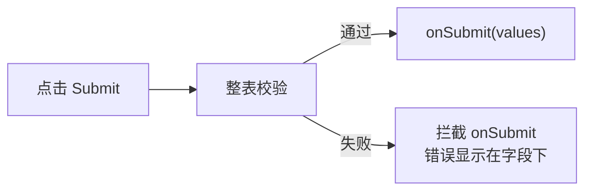

import {Demo} from '../../Demo';
import {BasicFormDemo} from '../../demos/BasicFormDemo';

# 基础表单

> `Form` + `Form.Field` 自动注入 `value`/`onChange`，控件丢进去即受控。`Form.Submit` 等校验通过再触发 `onSubmit`。

<Demo title="基础表单">
    <BasicFormDemo />
</Demo>
```tsx
import { Form } from 'rsform';

<Form
  initialValues={{ username: '', age: 18 }}
  onSubmit={async values => {
    console.log(values); // { username, age }
  }}
>
  <Form.Field name="username" label="用户名" required>
    <Form.Input placeholder="请输入用户名" />
  </Form.Field>
  <Form.Field name="age" label="年龄" required>
    <Form.InputNumber min={0} />
  </Form.Field>
  <Form.Submit>提交</Form.Submit>
</Form>
```

## Form 容器

`Form` 做三件事：内部 `createForm` 建表单实例、`FormProvider` 注入上下文、再包一层空 `preName` 的 `FieldContext.Provider` 让相对路径 Field 能解析。你只需把字段塞进去。

| 属性 | 类型 | 说明 |
| --- | --- | --- |
| `initialValues` | `Record` | 初始值（同步） |
| `asyncInitialValues` | `() => Promise<Record>` | 异步初始值；表单等其 resolve 后挂载，loading 期间渲染占位 |
| `effects` | `EffectFn \| EffectFn[]` | 联动逻辑；数组按序扇出。见 [Effects 详解](/advanced/effects-detail) |
| `onSubmit` | `(values) => void \| Promise` | 提交回调。**校验通过后才执行** |
| `formRef` | `MutableRefObject` | 拿到 form 实例（`formRef.current.submit()` / `.reset()` / `.values`） |
| `validateFailed` | `'scroll' \| (field) => void` | 校验失败处理；`'scroll'` 滚到首个错误 |

## 提交流程



`onSubmit` 拿到的 `values` 已是普通对象（库内 `toJS` 转过），可直接 `JSON.stringify` / 发请求。

## Form.Field 核心机制

`Form.Field` 包 Formily `<Field>`，用 `commonMap` 自动把 `field.value` / `field.onInput` 桥接成 antd 控件的 `value` / `onChange`——控件丢进去即受控，无需手写 `useState` + `value=` + `onChange=`。

选项类控件（Radio/Switch）还会自动把 `value` 互换成 `checked`。

## 字段 props

| 属性 | 说明 |
| --- | --- |
| `name` | 字段路径，支持相对路径（`.foo` / `..foo` 在 ArrayItems 行内解析到当前行） |
| `label` | label 文本（首选；`title` 为向后兼容别名） |
| `required` | 显示红星 **且** 触发非空校验（submit 空值被拦截） |
| `validator` | 同步/异步校验，返回空串表示通过，非空串为错误信息 |
| `editable` | `false` 时字段只读，渲染为文本态（不渲染控件） |
| `format` / `parse` | 值边界转换。`format` 写入控件前变换，`parse` onChange 后写入表单前变换 |
| `selectFirst` | 挂载时自动选首项（单选 option 控件） |

:::warning
`required` 不是「仅展示红星」——它会拦截 submit 空值。只想展示红星不校验？在 `label` 文本前手拼，别用 `required`。
:::

### 值边界转换

`format(value)` / `parse(value)` 用于在控件边界做值类型转换。典型场景是 DatePicker：传给 `Form.Field` 时用这对做 string ↔ Dayjs 转换。

```tsx title="DatePicker 的 string ↔ Dayjs"
<Form.Field
    name="date"
    label="日期"
    format={(v) => (v ? dayjs(v) : v)}
    parse={(v) => (v ? v.toISOString() : v)}
>
    <Form.DatePicker />
</Form.Field>
```

:::tip
表格列用 `'date'` 已内置这个转换——`DateCell` 存 ISO 字符串，边界转 Dayjs。
:::

## 常见坑

<details>
<summary>类实例别直接进 <code>form.values</code></summary>

Formily 响应式 Proxy 会序列化类实例（dayjs / moment 等）。用 `format`/`parse` 在控件边界做值类型转换，仿照表格内置的 `'date'` 列。

</details>

<details>
<summary><code>required</code> 会触发校验</summary>

`required` 显示红星 **且** 触发非空校验——submit 空值会被拦截。只想展示红星不校验，在 `label` 文本前手拼 `*`，别用 `required`。

</details>

## 下一步

- [Form.Consumer 订阅](/components/consumer) — 订阅表单值做派生展示
- [Effects 详解](/advanced/effects-detail) — 字段联动与跨字段校验
- [API 参考](/advanced/api) — 完整 props
