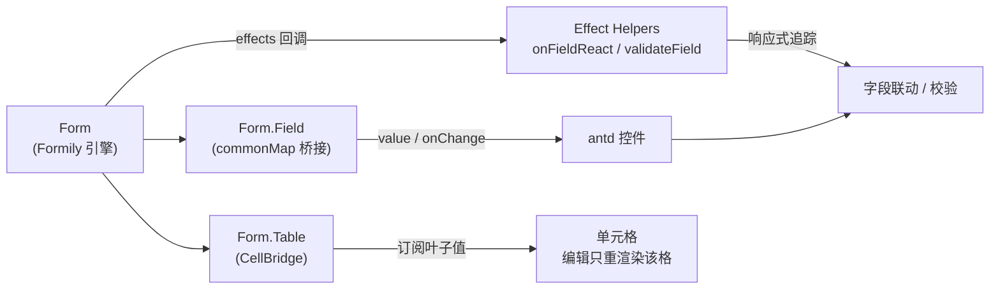

# 介绍

> Formily v2 + antd 5 的高性能 React 表单库。

rsform 在 Formily 响应式引擎之上做了一层薄壳封装：自动注入 Field、声明式 Effect 联动、单元格级渲染的高性能表格。写表单不再堆样板代码。

## 这是什么

Formily 的响应式引擎很强，但直接用 `@formily/react` 样板太多——每个字段要手写 `value/onChange`、联动要手动订阅、可编辑表格每个格子做成完整 Field 导致 N×M 订阅卡顿。

rsform 解决三件事：

- **自动注入** — `Form.Field` 用 `commonMap` 把 Formily 的 `field.value`/`field.onInput` 桥接成 antd 控件的 `value`/`onChange`
- **effect 糖** — `effects={$ => ...}` 注入常用 helper 集，声明式联动与跨字段校验
- **高性能表格** — 单元格只订阅叶子值，写入走 `onInput`，编辑一格只重渲染一格

## 为什么

与原生 antd `Form` 的核心差异：

| 维度 | 原生 antd Form | rsform |
| --- | --- | --- |
| 联动 | 手动 `useWatch` / `dependencies` + `shouldUpdate` | `effects` 回调声明，响应式自动追踪 |
| 跨字段校验 | `validator` 里手写跨字段逻辑 | `onFieldReact` / `validateField` 声明式 |
| 可编辑表格 | 每格受控，N×M 重渲染 | 单元格订阅叶子值，编辑一格只重渲染一格 |
| 模板代码 | 每字段 `value`/`onChange` 样板 | `Form.Field` 自动注入 |
| 引擎 | 手动 `useState` + `setState` | Formily 响应式引擎 |

:::tip
rsform 不是替代 antd 控件，而是替代 antd `Form` 这一层。控件仍是 antd 5 原生组件。
:::

## 核心能力

- **Effect 驱动联动** — 在 `effects` 回调里用 `$` helper 声明字段联动、跨字段校验、级联派生
- **自动注入 Field** — 控件丢进 `Form.Field`，`value`/`onChange` 自动流转，零样板
- **高性能表格** — 单元格非 Formily Field，编辑一格只重渲染该格，N×M 不卡
- **ArrayItems 列表** — 增删、上下移开箱即用，零拖拽依赖
- **草稿恢复** — `useFormDraft` 自动保存 / 恢复表单值
- **统一入口** — `import { Form } from 'rsform'` 一个 `Form` 拿到全部语法糖

## 架构

:::info
Formily 响应式引擎自动追踪依赖：你在 `effects` 里读了哪个字段，引擎就订阅它，无需手动声明依赖。
:::

## 技术栈

- **引擎** — `@formily/core` + `@formily/react` v2（MIT）
- **UI** — antd 5 + React 19
- **打包** — bundleless（`rslib`）
- **测试** — Vitest

## 适用场景

- 中后台表单，字段间有联动 / 跨字段校验 / 级联派生
- 大数据量可编辑表格（N×M 单元格）需要流畅编辑
- 想用 Formily 响应式但不想写大量样板代码

## 下一步

- [快速上手](/intro/quickstart) — 从零搭建一个完整表单
- [基础表单](/components/basic) — 自动注入与提交校验
- [可编辑表格](/components/table) — 单元格级渲染
